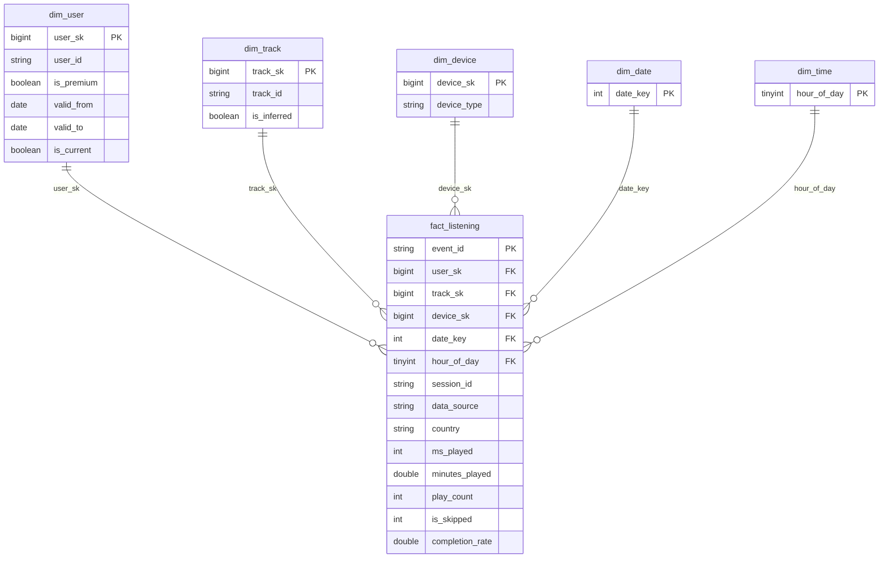

# AGENTS-PHASE-3.md — Spotify Medallion Pipeline (Gold, BI, Report)

Read this before touching anything for Phase 3. It **overrides** `AGENTS.md` / `AGENTS-PHASE-2.md` wherever they disagree (older docs describe Gold as a plan; this file describes what to build and what the repo actually contains). Everything about Landing → Bronze → Silver, PII, the generators and the data dictionary for those layers stays as written in `AGENTS-PHASE-2.md` and `docs/DATA_DICTIONARY.md`.

**Phase 3 due: Oct 24, 2026.** Deliverables: (1) GitHub repo with end-to-end PySpark notebooks, (2) Power BI `.pbix` / Tableau `.twbx` / public link, (3) architecture + FinOps PDF.

---

## 1. Repo audit (state at start of Phase 3)

| Area | State | Consequence |
|---|---|---|
| `00_config`, `01_setup`, `10`, `20`, `21`, `run_pipeline` | Done, working, with logging (`log_run`), widgets, MERGE + `_row_hash` | Extend, do not rewrite |
| `30_gold_dims`, `31_gold_fact`, `32_gold_ml`, `33_gold_marts`, `40_serving_export`, `90_demos` | **Placeholders** (markdown + comment-only cell) | Build all of them |
| `00_config` | Has `BRONZE_*`, `SILVER_*`, `OPS_SCHEMA`, `INGESTION_LOG`, `EXECUTION_LOG`. **No `GOLD_SCHEMA`, no Gold table names, no business-rule constants** | Add (section 4) |
| `01_setup` | Creates bronze/silver/ops only. **Change Data Feed is NOT enabled on `silver.events`**; no `ops.pipeline_state`; no `gold` schema | Add (section 4). CDF only records changes from the version it is enabled, so see the bootstrap rule in 5.2 |
| `run_pipeline` | Runs `01 → 10 → 20 → 21` only; hardcoded `NOTEBOOK_DIR` | Append Gold steps (section 6) |
| `log_run()` | Fine for Gold: `layer` is a free STRING | Use `layer = 'SILVER_TO_GOLD'`; do not change `PIPELINE_LOG_SCHEMA` |
| `execution_metrics()` | Reads `DESCRIBE HISTORY ... LIMIT 1` | **Call it right after the MERGE/write and before `OPTIMIZE`**, otherwise it reports the OPTIMIZE commit with zero rows |
| `silver.events` | `PARTITIONED BY (_partition_dt)`; MERGE deletes rows `NOT MATCHED BY SOURCE` inside the date range | Deletes arrive in CDF as `_change_type = 'delete'` and must be applied to the fact |
| `silver.users` | SCD1 (current row only, `is_premium` overwritten) | History is lost unless Gold captures it each run (5.1, `dim_user`) |
| `output/dims/users.json` | One snapshot, **no `is_premium` flips** (generator status item still open) | SCD2 and the propensity story need real changes: add a flip in the generator or upload a hand-edited `users.json` as a second delivery for the demo |
| `silver.events.device_type` | Controlled list is `mobile, desktop, web_player, smart_speaker, other` | The older `dim_device` list (console, tablet, tv) does not exist in the data. Use the 5 real values (5.1) |
| Landing in git | Only `dt=2021-03-06` and `sample_events.json`; the full 450-day set lives on the owners' machines / in the Volume | Do not assume the full data is in the clone; test locally on the sample, validate on Databricks |
| `dashboards/README.md`, `tests/README.md`, `docs/` | Stubs / Phase 2 only | Fill (section 9) |
| Two copies of the Phase 2 agent file (`AGENTS-PHASE-2.md`, `notebooks/AGENTS_PHASE-2.md`) | Different documents (full spec vs. formatting run report) | Leave alone; this file lives at repo root next to `AGENTS.md` |

---

## 2. Requirement → implementation map

| Phase 3 requirement | Implementation | Where |
|---|---|---|
| Star schema, facts + dims, not a Silver copy | `gold.fact_listening` + `dim_user` (SCD2), `dim_track`, `dim_date`, `dim_time`, `dim_device` | `30`, `31` |
| ER diagram / Gold data dictionary | Section 5.5 below, mirrored to `docs/GOLD_DATA_DICTIONARY.md` (Mermaid ER + PK/FK tables) | `docs/` |
| Read optimisation (`OPTIMIZE`, Liquid Clustering) | `CLUSTER BY` on fact + large dims, `OPTIMIZE` at end of run, before/after evidence | `01_setup`, `40` |
| Gold linked to the end of the pipeline, auto-refresh | `run_pipeline` runs `30 → 31 → 32 → 33 → 40` after `21`; CDF-driven incremental fact, MERGE dims, overwrite marts | `run_pipeline` |
| Logging continues to Gold | One `log_run('SILVER_TO_GOLD', ...)` per Gold table: rows read (aggregated), inserted/updated/deleted, `duration_sec`, status, from a `finally`/except path | every Gold notebook |
| BI connected to Databricks, 3+ visuals, business questions from Phase 1, audit/error visuals | Power BI reads `gold` only; audit data exposed as `gold.audit_*` marts | `dashboards/`, `.pbix` |
| Semantic layer mirrors the star | One-to-many, single-direction relationships in Model view; measures defined once | `.pbix` |
| PDF report: diagram, decision log, Spark UI DAG, FinOps | Section 8 outline | `docs/report/` |

---

## 3. Non-negotiable rules (inherited + new)

1. Bronze append-only; Silver row-level; **surrogate keys, SCD2, business rules and aggregations only in Gold**.
2. **Gold dims before Gold fact; marts last.** Enforced by notebook order in `run_pipeline`.
3. Every notebook is parameterised with the existing widgets (`landing_root`, `catalog_name`, `start_date`, `end_date`, `load_type`, `batch_id`) via `%run ./00_config`. No hardcoded catalog, path or "today".
4. No `inferSchema`; explicit DDL in `01_setup` for every Gold table (comments on table and every column, `NOT NULL` where true, `load_timestamp` on every row).
5. Every Gold write goes through Delta (`saveAsTable` / `MERGE`), never plain Parquet.
6. Idempotent: rerun with no new Silver changes → `SKIPPED_UNCHANGED` logs, no new commits, no duplicate rows.
7. A failing Gold step logs `FAILURE` with `error_message`, then re-raises; `run_pipeline` stops there. A single bad row never fails Gold (Silver already quarantined it).
8. **PII**: Gold carries pseudonymous `user_id` only. No raw `raw_record` text from quarantine tables reaches Gold or Power BI (aggregate counts by rule/reason only). Do not add real names anywhere. `.pbix` must not embed the Databricks token (use a parameter / personal access token entered at refresh time).
9. Never "fix" an empty Gold result by loosening Silver rules.

---

## 4. Changes to existing files (do these first)

### 4.1 `00_config.ipynb`

Add after the Silver names:

```python
GOLD_SCHEMA = f'{CATALOG_NAME}.gold'
GOLD = {n: f'{GOLD_SCHEMA}.{n}' for n in (
    'dim_user', 'dim_track', 'dim_date', 'dim_time', 'dim_device', 'fact_listening',
    'ml_user_track_interactions', 'ml_track_features', 'ml_user_sessions',
    'peak_usage_patterns', 'subscription_propensity_segments',
    'content_performance_trends', 'wrapped_user_year',
    'audit_pipeline_runs', 'audit_quality_summary', 'audit_freshness')}
PIPELINE_STATE = f'{OPS_SCHEMA}.pipeline_state'

# Business rules live here and are used by Gold notebooks only (mirror scripts/generate_data_v2.py lines ~183-188)
W1_VOLUME, W2_DEVICE_DIVERSITY, W3_COMPLETION, W4_DISCOVERY = 0.40, 0.20, 0.20, 0.20
HIGH_PROPENSITY_THRESHOLD = 0.55
PROPENSITY_TIERS = (0.55, 0.35)          # High >= 0.55, Medium >= 0.35, else Low (tune against user_segments.json)
DISCOVERY_LOOKBACK_DAYS = 60
QUARANTINE_ALERT_RATE = 0.02
UNKNOWN_SK = -1
OPEN_ENDED = '9999-12-31'
FIRST_VALID_FROM = '1900-01-01'
DEVICE_CATEGORY = {'mobile': 'mobile', 'desktop': 'desktop', 'web_player': 'web', 'smart_speaker': 'smart_speaker', 'other': 'other'}
```

Add helper `sk(*cols)` = `F.xxhash64(F.concat_ws('||', *cols))` (deterministic surrogate key, see decision log). Keep `log_run`/`execution_metrics` unchanged.

### 4.2 `01_setup.ipynb`

- `CREATE SCHEMA IF NOT EXISTS gold`.
- `ALTER TABLE silver.events SET TBLPROPERTIES (delta.enableChangeDataFeed = true)` **and record the version**:
  ```python
  v = spark.sql(f"DESCRIBE HISTORY {table_ref(SILVER_EVENTS)} LIMIT 1").first()['version']
  ```
  Insert `(silver.events, last_version = NULL, cdf_enabled_at_version = v)` into `ops.pipeline_state` only if no row exists.
- `ops.pipeline_state` DDL: `table_name STRING NOT NULL, last_version BIGINT, cdf_enabled_at_version BIGINT, updated_at TIMESTAMP, load_timestamp TIMESTAMP NOT NULL`.
- Explicit DDL for every Gold table (5.5), `CLUSTER BY` on `fact_listening` and `dim_user`/`dim_track` (not `PARTITIONED BY`; they cannot be combined). Dims `dim_date`, `dim_time`, `dim_device` are tiny: no clustering.
- `CHECK` constraints: `fact_listening.ms_played_minutes >= 0`, `dim_user.valid_from < valid_to`, `dim_date.date_key BETWEEN 19000101 AND 99991231`.
- Add the Gold tables to the "Proof: Explicit Schemas" cell at the bottom.

### 4.3 `run_pipeline.ipynb`

Replace the child list with `01_setup, 10, 20, 21, 30, 31, 32, 33, 40` (timeouts 300/1800/600/1800/600/1800/900/900/900). Derive `NOTEBOOK_DIR` from `dbutils.notebook.entry_point...notebookPath()` instead of the hardcoded user path so a teammate can run it. Keep one `batch_id` for the whole run. Print a final one-screen summary read from `ops.pipeline_execution_logs` for this `run_id`.

---

## 5. Gold design (what to build)

### 5.1 Dimensions (`30_gold_dims`)

| Table | Business key | Surrogate key | Load | Notes |
|---|---|---|---|---|
| `dim_date` | `date_key` INT yyyymmdd | = `date_key` | overwrite, generated | Range: `min(_partition_dt)`−0 to `max`+365; cols: `date, year, quarter, month, month_name, week_of_year, day_of_week, day_name, is_weekend`. Use Spark's `dayofweek` convention (1 = Sunday) to match `silver.events.day_of_week` |
| `dim_time` | `hour_of_day` | = `hour_of_day` | overwrite, 24 rows | `hour_label`, `day_part` (Night 0-5, Morning 6-11, Afternoon 12-17, Evening 18-23) |
| `dim_device` | `device_type` | `device_sk = sk(device_type)` | MERGE SCD1 | Exactly the 5 Silver values; `device_category` from `DEVICE_CATEGORY`; plus `-1 Unknown` member |
| `dim_track` | `track_id` | `track_sk = sk(track_id)` | MERGE SCD1 + **inferred members** | From `silver.tracks`; then insert any `track_id` in `silver.events` missing from the dim as `is_inferred = true`, `genre = 'unclassified'`. A later catalog refresh updates the row and flips `is_inferred = false`; the SK never changes. Column is `artist_name`; `release_year` nullable |
| `dim_user` | `user_id` | `user_sk = sk(user_id, valid_from)` | **SCD2** MERGE | Type 2 on `is_premium`; Type 1 on `country`, `timezone`. `valid_from = 1900-01-01` for first version, snapshot timestamp afterwards; `valid_to = 9999-12-31`; `is_current`; `type1_hash`, `type2_hash`; `source_system` = `real` if `user_id LIKE 'user_real_%'` else `synthetic` |

SCD2 MERGE: use the staged UNION pattern already written in `AGENTS-PHASE-2.md` (Loading dimensions). Snapshot timestamp = `max(load_timestamp)` of the `silver.users` rows read, so reruns with an unchanged Silver produce **no** new version (compare `type2_hash`). Because `silver.users` is SCD1, run `30_gold_dims` on every pipeline run; a flip that happens between two runs is captured at the next run.

### 5.2 Fact (`31_gold_fact`) — incremental via CDF

Grain: **one row per play event** (`event_id`).

Flow:
1. Read `ops.pipeline_state` for `silver.events`. Let `cur = latest version of silver.events`.
2. **Bootstrap**: if `last_version IS NULL`, the fact has never been loaded. Load from a **full snapshot** of `silver.events` (CDF has no rows before `cdf_enabled_at_version`), then set `last_version = cur`.
3. Else if `last_version == cur` → log `SKIPPED_UNCHANGED`, stop.
4. Else read changes `startingVersion = last_version + 1`, drop `update_preimage`. Keep only the **latest** change per `event_id` (`row_number() over (partition by event_id order by _commit_version desc)`), since a range can contain several commits for one event.
5. Split: `delete` rows → `DELETE FROM fact WHERE event_id IN (...)` (via MERGE `WHEN MATCHED AND s._change_type = 'delete' THEN DELETE`); `insert` / `update_postimage` rows → enrich and upsert.
6. Enrich: `date_key = yyyymmdd(played_at)`; `hour_of_day`; `device_sk` (left join, default `UNKNOWN_SK`); `track_sk` (after inferred members inserted); `user_sk` by **point-in-time** join `played_at >= valid_from AND played_at < valid_to`; measures `ms_played`, `minutes_played = ms_played/60000.0`, `play_count = 1`, `is_skipped` 0/1, `completion_rate`; degenerate `event_id`, `session_id`, `data_source`; `country` (from the user version).
7. `MERGE INTO gold.fact_listening ON event_id`, guarded by a row hash so unchanged rows are not rewritten. `created_at` on insert, `updated_at` on update.
8. Read `execution_metrics()` → `log_run`; **only after a successful commit** write `last_version = cur` to `ops.pipeline_state`.

Notes: `real_api` rows have NULL `ms_played`/`skipped`/`completion_rate`. Keep them as NULL (not 0) so averages are correct; marts that need completion must filter `data_source <> 'real_api'`. Late dimension change (new `dim_user` version) never rewrites old facts.

Fact columns: `event_id` (PK), `user_sk`, `track_sk`, `device_sk`, `date_key`, `hour_of_day` (FKs), `session_id`, `data_source`, `country`, `ms_played`, `minutes_played`, `play_count`, `is_skipped`, `completion_rate`, `_row_hash`, `created_at`, `updated_at`, `load_timestamp`.

### 5.3 ML tables (`32_gold_ml`) and marts (`33_gold_marts`)

Full recompute with `mode('overwrite')` + `overwriteSchema` is acceptable here (tens of thousands to low millions of rows) and is idempotent by construction. Defend this in the decision log; note that at enterprise scale these become incremental or Materialized Views.

ML (from `silver.events` + `silver.tracks`, business keys): `ml_user_track_interactions`, `ml_track_features`, `ml_user_sessions` — columns as in `AGENTS-PHASE-2.md` G2. Exclude `data_source = 'real_api'` from any completion-based feature.

Marts (from the star schema):

| Table | Business question | Notes |
|---|---|---|
| `peak_usage_patterns` | When do users listen most (capacity planning)? | hour × day_of_week × device_category × country: plays, minutes. Provide both UTC hour and `local_hour` computed with `from_utc_timestamp(played_at, dim_user.timezone)`; heatmap uses local, capacity view uses UTC |
| `subscription_propensity_segments` | Which free users behave like premium users? | One row/user: minutes, session frequency, `genre_diversity`, `skip_rate`, `device_diversity` (normalised), `discovery_rate`, `volume_norm`, `engagement_score = W1·volume_norm + W2·device_diversity + W3·(1−skip_rate) + W4·discovery_rate`, `tier`, `is_high_conversion_propensity = NOT is_premium AND score >= threshold`. `discovery_rate` = share of plays on a track not played by that user in the previous 60 days. Reconcile against `output/validation/user_segments.json` (expect the planted high-propensity free users) and report the match rate |
| `content_performance_trends` | Which genres/artists are rising or falling? | Monthly share of listening minutes by genre and by artist, `mom_delta`; `unclassified` kept as its own group so shares sum to 100% |
| `wrapped_user_year` | Consumer "Wrapped" page | One flat row per user per year: `total_minutes`, `top_artist_1..5`, `top_genre_1..3`, `top_track_1..5`, `discovery_rate`, `peak_hour` (no arrays) |
| `audit_pipeline_runs` | Is the pipeline healthy and how long does it take? | Daily/layer/table aggregate of `ops.pipeline_execution_logs`: runs, status counts, rows in/out, `duration_sec` p50/max |
| `audit_quality_summary` | How much data do we reject and why? | Counts by `_reason` (Bronze quarantine) and `_dq_rule` (Silver quarantine) per `_partition_dt`/batch, plus quarantine rate vs `QUARANTINE_ALERT_RATE`. **Counts only, never `raw_record`** |
| `audit_freshness` | How current is each layer? | Latest `_partition_dt`, latest `load_timestamp`, row counts per layer/table |

Every mart logs one `SILVER_TO_GOLD` row. `rows_read` = rows scanned from the fact/Silver for that mart, `rows_inserted` = rows written.

### 5.4 Serving / optimisation (`40_serving_export`)

1. **Reconciliation** (log as a `SILVER_TO_GOLD` / `target_table = 'reconciliation'` row, failure only warns): `count(silver.events)` vs `count(fact_listening)`; orphan check (fact FKs without a dim row must be 0); `sum(play_count)` by `date_key` vs Silver by `_partition_dt`; quarantine rate; latest `dt`.
2. **OPTIMIZE** `fact_listening`, `dim_user`, `dim_track` (Liquid Clustering makes plain `OPTIMIZE` incremental). `OPTIMIZE bronze.events` occasionally (many small daily files). Capture `DESCRIBE DETAIL` (`numFiles`, `sizeInBytes`) and `OPTIMIZE` metrics **before and after** into a small table or the notebook output: this is report evidence.
3. `ANALYZE TABLE ... COMPUTE STATISTICS FOR ALL COLUMNS` on the fact and the large dims.
4. **Serving**: if the workspace exposes a SQL warehouse, Power BI connects directly (section 7). Otherwise write every `gold.*` table as CSV/Parquet to `<landing_root>/serving/` (overwrite per run) and import those. Either way Power BI never reads Bronze or Silver.
5. Run `OPTIMIZE` **after** you have read `execution_metrics()` for the same table (see audit).

### 5.5 Gold data dictionary (mirror to `docs/GOLD_DATA_DICTIONARY.md`)

PK/FK are documented, not enforced by Delta (you may declare informational `PRIMARY KEY`/`FOREIGN KEY ... NOT ENFORCED` constraints in Unity Catalog if available; Power BI can use them for relationship hints).



| Table | PK | FKs | Key columns (type) |
|---|---|---|---|
| `gold.fact_listening` | `event_id` | `user_sk`, `track_sk`, `device_sk` (BIGINT), `date_key` (INT), `hour_of_day` (TINYINT) | `session_id` STRING, `data_source` STRING, `country` STRING, `ms_played` INT null, `minutes_played` DOUBLE null, `play_count` INT, `is_skipped` INT null, `completion_rate` DOUBLE null, `_row_hash`, `created_at`, `updated_at`, `load_timestamp` |
| `gold.dim_user` | `user_sk` (BK `user_id` + `valid_from`) | – | `user_id`, `source_system`, `country`, `timezone`, `is_premium`, `valid_from` TIMESTAMP, `valid_to` TIMESTAMP, `is_current` BOOLEAN, `type1_hash`, `type2_hash`, `created_at`, `updated_at`, `load_timestamp` |
| `gold.dim_track` | `track_sk` (BK `track_id`) | – | `track_name`, `artist_name`, `genre`, `release_year` INT null, `duration_sec`, `popularity`, `danceability`, `energy`, `valence`, `tempo_bpm`, `is_inferred`, `created_at`, `updated_at`, `load_timestamp` |
| `gold.dim_device` | `device_sk` (BK `device_type`) | – | `device_category`, `load_timestamp` |
| `gold.dim_date` | `date_key` | – | `date`, `year`, `quarter`, `month`, `month_name`, `week_of_year`, `day_of_week`, `day_name`, `is_weekend` |
| `gold.dim_time` | `hour_of_day` | – | `hour_label`, `day_part` |
| Marts / ML / audit | see 5.3 | marts carry `user_id` / `date_key` where needed | each has `load_timestamp` |

The unknown member (`-1`) exists in `dim_user`, `dim_track`, `dim_device` so a fact is never dropped for a missing key.

---

## 6. Pipeline integration and logging

Run order inside `run_pipeline` (one `batch_id`, one `run_id`):

```
01_setup → 10_bronze_ingest → 20_silver_dims → 21_silver_events
        → 30_gold_dims → 31_gold_fact → 32_gold_ml → 33_gold_marts → 40_serving_export
```

- A new `dt=` file landing → Bronze loads it → Silver MERGE → Silver CDF version → `31` picks it up by version → marts overwrite → serving export. No manual step.
- Logging rows to emit (all with `layer = 'SILVER_TO_GOLD'`, `parameter = 'start..end'` or `'cdf v{a}..v{b}'` for the fact):
  `gold.dim_user, dim_track, dim_device, dim_date, dim_time, fact_listening, ml_*, peak_usage_patterns, subscription_propensity_segments, content_performance_trends, wrapped_user_year, audit_*`, plus `reconciliation`.
- `status` is `SUCCESS` / `FAILURE` / `SKIPPED_UNCHANGED`. Wrap each notebook body in `try/except`, log from the except path, re-raise.
- Scheduling: if the workspace supports Databricks Jobs, create a job running `run_pipeline` (daily, parameter `load_type = incremental`, empty dates → latest landing partition). Otherwise document manual triggering. Screenshot the job or the manual run in the report.

---

## 7. Power BI

- Preferred: **Azure Databricks** connector (Get Data → Databricks), server hostname + HTTP path of a SQL warehouse, personal access token entered at connect time. Import mode, schema `gold`.
- Fallback (no SQL warehouse/token on Free Edition): import the CSV/Parquet files from `serving/` (section 5.4). Say which one you used in the report; do not claim a live connection you do not have.
- **Model view**: relationships `fact_listening[user_sk] → dim_user[user_sk]`, same for `track_sk`, `device_sk`, `date_key`, `hour_of_day`; all many-to-one, single direction, one active relationship per dimension. `dim_user` is joined by `user_sk` (not `user_id`), so each play sees the user version valid at play time. Mark `dim_date[date]` as the date table. Hide SK columns from report view. Marts connect to `dim_user`/`dim_date` only if needed; standalone marts are fine.
- **Measures** (define once): `Total Minutes = SUM(fact[minutes_played])`, `Plays = SUM(fact[play_count])`, `Skip Rate = AVERAGE(fact[is_skipped])` (real_api rows are NULL and ignored), `Active Users = DISTINCTCOUNT(dim_user[user_id])`, `Discovery Rate`, `Quarantine Rate`.
- **Pages** (minimum 3 distinct visuals, aim for these):
  1. *Peak usage*: heatmap (matrix, conditional format) hour × weekday + device slicer. (Q1)
  2. *Subscription propensity*: clustered bar, users per tier split by `is_premium`; the "High engagement, still Free" bar is the insight; KPI cards. (Q2)
  3. *Content trends*: line chart of genre share over time + top rising/falling table. (Q3)
  4. *Wrapped*: user slicer → top artists/genres/tracks, total minutes, discovery rate.
  5. *Pipeline health (audit)*: run duration by layer over time, status counts, rows in/out, quarantine rate by rule, freshness cards. Built from `gold.audit_*`.
- Save as `dashboards/spotify_wrapped.pbix` (strip credentials) and update `dashboards/README.md` with screenshots and the relationship diagram.

---

## 8. Report (PDF) — outline and evidence to capture

Write `docs/report/REPORT.md` and export to PDF. Capture evidence **while running**, not afterwards.

1. **Architecture diagram** (draw.io / Mermaid → PNG): sources (3 producers) → Landing `dt=` files → Bronze → Silver → Gold (star + marts + audit) → Power BI, with `ops` logs alongside.
2. **Data model**: the ER diagram from 5.5.
3. **Decision log** (each entry: decision → alternatives → why → trade-off):
   - Partitioning: `bronze.events` and `silver.events` partitioned by `_partition_dt` to match landing partitions, make idempotent re-delivery and `NOT MATCHED BY SOURCE` MERGE touch only the requested days. Honest trade-off: ~450 daily partitions of small data means many small files, hence `OPTIMIZE` on Bronze. Gold uses **Liquid Clustering** (`date_key`, `user_sk`) instead of partitions because the data is small, query patterns vary, and clustering can change without a rewrite.
   - Schema drift: additive columns → `mergeSchema` + `SCHEMA_DRIFT` note in the log; type changes → `bronze.events_quarantine` (`TYPE_MISMATCH`); cite the actual run and log row from the demo.
   - PII: only pseudonyms reach the lakehouse; `ip_addr`, device model, `conn_country` and podcasts dropped at sanitization (documented deviation from "encrypt"); quarantine raw text never exposed to BI; right-to-be-forgotten procedure (`DELETE` → `REORG ... APPLY (PURGE)` → `VACUUM`) from `docs/PII_NOTES.md`.
   - Surrogate keys: deterministic `xxhash64` rather than identity columns (rebuildable, idempotent after `RESTORE`, no identity/MERGE concurrency limits); collision risk negligible at this cardinality; `-1` unknown members.
   - SCD2 only on `is_premium`; point-in-time fact join; inferred members for early-arriving tracks.
   - CDF-driven fact vs. recompute; marts recomputed because data is small.
   - Serving mode (direct SQL warehouse vs. exported files) and why.
4. **Spark UI / DAG analysis**: screenshot the DAG of the most complex transformation (the `31_gold_fact` MERGE or the `33` propensity/discovery window query). Explain from the plan: scan with **partition pruning / predicate pushdown** on `_partition_dt` and file statistics, **broadcast hash join** to the small dims (note the exchange that is *absent*), **shuffle** at the `row_number`/window and the MERGE join, **AQE** coalescing partitions, and bytes read vs. bytes written. Use `df.explain('formatted')` output as supporting text. **If the workspace is serverless (Free Edition), there is no classic Spark UI**: use the **Query Profile / query plan DAG** instead and say so in one sentence in the report.
5. **FinOps**: see 8.1.
6. **Evidence appendix**: `ops.pipeline_execution_logs` screenshot spanning all three layers incl. `SILVER_TO_GOLD`; idempotent rerun; reconciliation output; `OPTIMIZE` before/after.

### 8.1 FinOps method (use measured numbers, do not invent prices)

- Measure: a typical **daily incremental run** = sum of `duration_sec` for one `run_id` in `ops.pipeline_execution_logs` (all layers); also cluster/serverless startup time which the log does not capture (note it).
- Convert: `cost ≈ compute_hours × DBU_per_hour × price_per_DBU (+ VM/storage if classic)`. Look up the current DBU rate and price for the SKU actually used (serverless jobs / SQL warehouse) on the Azure Databricks pricing page and cite the date. On Free Edition/credits there is no bill: say so, and present the formula plus an estimate.
- Extrapolate: hourly for a year = 24 × 365 = 8,760 runs. Scale the measured per-run **compute** (not the 450-day backfill) by that count, then add storage (Delta size × retention incl. time travel) and BI refresh cost. State assumptions (data volume growth, concurrency) explicitly.
- Optimisations to discuss: process only changed partitions (already), CDF instead of full recompute, auto-stop/serverless job compute instead of always-on clusters, `OPTIMIZE`/clustering cadence (daily not hourly), `VACUUM` retention, Photon where it pays off, incremental/materialised marts, hourly → micro-batch/Auto Loader or trigger-once only when freshness needs it, Power BI refresh schedule decoupled from pipeline cadence, small-file avoidance.

---

## 9. Tests and demos

`tests/README.md` is a stub: add `tests/gold_checks.md` (or a final notebook cell) with these assertions, run after every pipeline execution; each prints PASS/FAIL:

- `fact_listening` row count = `silver.events` row count; `count(distinct event_id)` = count.
- No orphan FKs (fact → each dim) and no `-1` keys unless explained (inferred members counted separately).
- Exactly one `is_current` row per `user_id`; SCD2 intervals do not overlap or leave gaps.
- `sum(minutes_played)` fact = Silver `sum(ms_played)/60000` (excluding NULLs).
- Rerun with no new data → zero inserted/updated/deleted in every Gold log row.
- Propensity vs `user_segments.json`: report match rate.
- Mart shares sum to ~100% per month.

`90_demos` — Gold scenarios to add (after the Phase 2 set):

| # | Scenario | Shows |
|---|---|---|
| G1 | New `dt` file lands → whole pipeline refreshes Gold | End-to-end automation, CDF incremental |
| G2 | Redelivered/changed day (backfill) | Silver deletes → fact deletes via CDF |
| G3 | Upload `users.json` with flipped `is_premium` | SCD2 new version, old plays keep old `user_sk` |
| G4 | Play of an unseen `track_id` | Inferred member → later filled, SK unchanged |
| G5 | Idempotent rerun | `SKIPPED_UNCHANGED`, no commits |
| G6 | `OPTIMIZE` + clustering | Files/bytes before vs after, query time before vs after |
| G7 | `DESCRIBE HISTORY` / `RESTORE` on a Gold table | Time travel on Gold |

---

## 10. Working conventions for this phase

- Build order: `01_setup`/`00_config` changes → `30` → `31` → test → `32` → `33` → `40` → `run_pipeline` → tests → Power BI → report. Commit after each notebook (small commits).
- Test against the 5-day slice first, then the full range; the repo clone only has one sample partition, so Databricks is where the real validation happens.
- Use `.withColumns({...})` (no long `withColumn` chains), docstrings on helpers, sectioned notebooks (markdown header per step), as in the Phase 2 formatting pass.
- Do not use `collect()` on fact-sized data; do not `repartition` blindly; do not cache.
- Any new doc: update the table catalog in `AGENTS.md` and `docs/DATA_DICTIONARY.md` / `docs/GOLD_DATA_DICTIONARY.md` in the same commit.
- Known open items to resolve or consciously defer: generator `is_premium` flips and dated dim snapshots; JSON Lines producers; `AGENTS.md` still lists Gold as "(still placeholders)".

---

## 11. Phase 3 checklist (due Oct 24, 2026)

- [x] `00_config`: Gold names, business-rule constants, `sk()` helper
- [x] `01_setup`: gold schema + DDL (comments, CHECKs, clustering), CDF on `silver.events`, `ops.pipeline_state`
- [x] `30_gold_dims`: date, time, device, track (+ inferred), user (SCD2)
- [x] `31_gold_fact`: bootstrap + CDF incremental, point-in-time `user_sk`, delete propagation, state update after commit
- [x] `32_gold_ml`, `33_gold_marts` (3 business questions + Wrapped + 3 audit marts + daily activity + cohort retention + skip rate)
- [x] `40_serving_export`: reconciliation, `OPTIMIZE` before/after evidence, stats, export (if needed)
- [x] `run_pipeline` extended to Gold; logs show `SILVER_TO_GOLD` rows with rows + duration
- [x] `docs/GOLD_DATA_DICTIONARY.md` with ER diagram and complete column definitions
- [ ] Tests (section 9) all PASS; demos G1-G7 captured (assertions authored in `tests/03_test_gold` and `tests/gold_checks.md`; live run capture in progress per `docs/report/evidence/CAPTURE.md`)
- [ ] Power BI model (relationships, measures), 5 pages, `.pbix` committed without credentials (`dashboards/README.md` complete with DAX spec; `.pbix` export pending)
- [x] Report PDF (`docs/report/REPORT.pdf`): architecture diagram, decision log, Photon DAG analysis (`explain_propensity_formatted.txt`), FinOps cost formulation, and complete empirical evidence appendix (17 pages, zero `TODO-MEASURED`, images verified via `pdfimages -list`)
- [x] Final repo pass: README status line, `AGENTS.md` status checklist, no real names, no tokens
