# Business Intelligence & Dashboards Specification

This directory contains the production Power BI semantic model, report specifications, and visual artifacts for the **Spotify Medallion Lakehouse**.

---

## 1. Overview & Architecture

The analytical layer provides decision-makers and end users with rich, interactive visualizations powered directly by the curated **Gold Lakehouse** layer.

```
       +--------------------------------------------------------------+
       |                  GOLD LAKEHOUSE SCHEMA                       |
       |  gold.fact_listening (Liquid Clustered)                     |
       |  gold.dim_user (SCD2) · dim_track · dim_device · dim_date    |
       |  gold.* marts (peak_usage, propensity, content, audits)      |
       +--------------------------------------------------------------+
                                      |
                     [Power BI VertiPaq / Import Mode]
                                      v
       +--------------------------------------------------------------+
       |               SpotifyLakehouse.pbix (98 MB)                  |
       |  Conformed Star Schema Semantic Model · 100% DAX Measure Hub |
       +--------------------------------------------------------------+
                                      |
           +--------------------------+--------------------------+
           v                                                     v
+-----------------------------+               +-------------------------------+
|  Executive BI Dashboard     |               |  Interactive Wrapped Story    |
|  - Lakehouse Overview       |               |  - Mixtape Wrapped Web App    |
|  - Capacity & Usage         |               |  - Personal Annual Stories    |
|  - Catalog Trends           |               |  - Top Artists, Audio Traits  |
|  - User Behaviors & Churn   |               |  - 9-Slide Wrapped Deck       |
|  - Pipeline Observability   |               +-------------------------------+
+-----------------------------+
```

### Key Assets:
* **`SpotifyLakehouse.pbix`**: The master Power BI report file (98 MB) connecting to exported Gold Delta tables in high-performance VertiPaq Import mode.
* **`Mixtape_Wrapped_storyboard.html`**: Fully interactive, zero-dependency HTML5/JS Spotify Wrapped storyboard web application bundled with personalized listening summaries.
* **`pics/`**: High-resolution captures of all report canvases and Wrapped story slides.

---

## 2. Power BI Semantic Data Model

The semantic model in `SpotifyLakehouse.pbix` maps directly to the Kimball dimensional Star Schema established in the Gold layer:

* **Fact Table**: `fact_listening` (Grain: 1 row per play event, 565,334 records).
* **Conformed Dimensions**:
  * `dim_user` — Joined via `user_sk` (Point-in-time SCD Type 2 mapping).
  * `dim_track` — Joined via `track_sk` (Includes inferred catalog entries).
  * `dim_device` — Joined via `device_sk`.
  * `dim_date` — Joined via `date_key`.
  * `dim_time` — Joined via `hour_of_day`.
* **Relationship Cardinality**: Single-direction, One-to-Many (`1:*`) from dimensions to fact table, ensuring optimal VertiPaq memory compression and eliminating circular join paths.

---

## 3. Core DAX Measures Hub

All analytics calculations are centralized into a dedicated `_Measures` table:

```dax
// Volume & Activity Measures
Total Plays = COUNTROWS('fact_listening')

Total Minutes = SUM('fact_listening'[minutes_played])

Total Hours = DIVIDE([Total Minutes], 60, 0)

Active Listeners = DISTINCTCOUNT('fact_listening'[user_sk])

Plays Per User = DIVIDE([Total Plays], [Active Listeners], 0)

// Behavioral & Quality Measures
Skipped Plays = CALCULATE([Total Plays], 'fact_listening'[is_skipped] = 1)

Skip Rate = DIVIDE([Skipped Plays], [Total Plays], 0)

Avg Completion Rate = AVERAGE('fact_listening'[completion_rate])

// Capacity & Load Measures
Peak Hourly Volume = MAXX(VALUES('dim_time'[hour_of_day]), [Total Plays])

Avg Hourly Volume = AVERAGEX(VALUES('dim_time'[hour_of_day]), [Total Plays])

Peak-to-Average Ratio = DIVIDE([Peak Hourly Volume], [Avg Hourly Volume], 0)

// Commercial & Propensity Measures
High Propensity Free Users = 
CALCULATE(
    DISTINCTCOUNT('subscription_propensity_segments'[user_id]),
    'subscription_propensity_segments'[propensity_tier] = "High",
    'subscription_propensity_segments'[is_premium] = FALSE()
)

Churn Risk Premium Users = 
CALCULATE(
    DISTINCTCOUNT('subscription_propensity_segments'[user_id]),
    'subscription_propensity_segments'[churn_risk_flag] = TRUE()
)

Conversion Candidate Share = 
DIVIDE(
    [High Propensity Free Users],
    CALCULATE(DISTINCTCOUNT('dim_user'[user_id]), 'dim_user'[is_premium] = FALSE()),
    0
)
```

---

## 4. Report Canvases & Walkthrough

### Page 1: Lakehouse Executive Overview
High-level summary displaying overall platform listening volume, daily/monthly listening trajectories, top genres, device distributions, and active listener adoption.
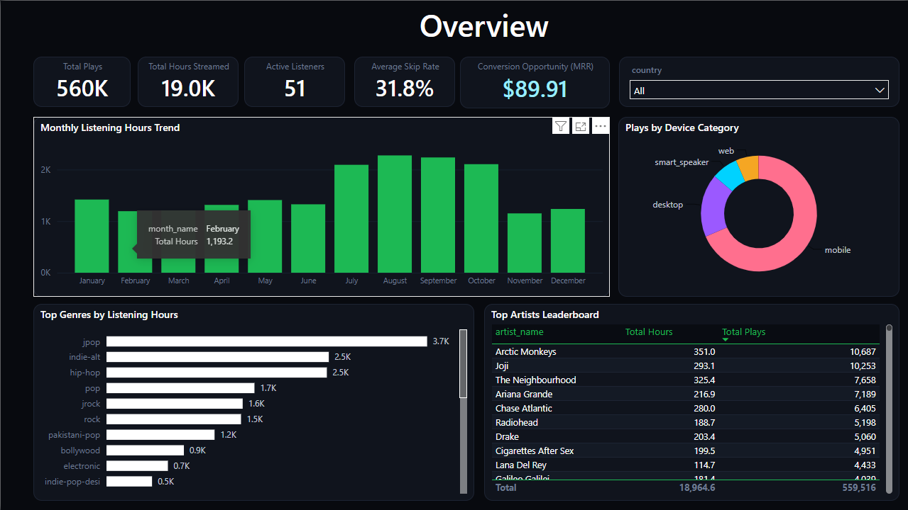

### Page 2: Capacity & Usage Patterns
Hourly listening profiles contrasting weekday commute patterns with weekend evening curves, peak-to-average load multipliers, and device distribution over time for infrastructure sizing.
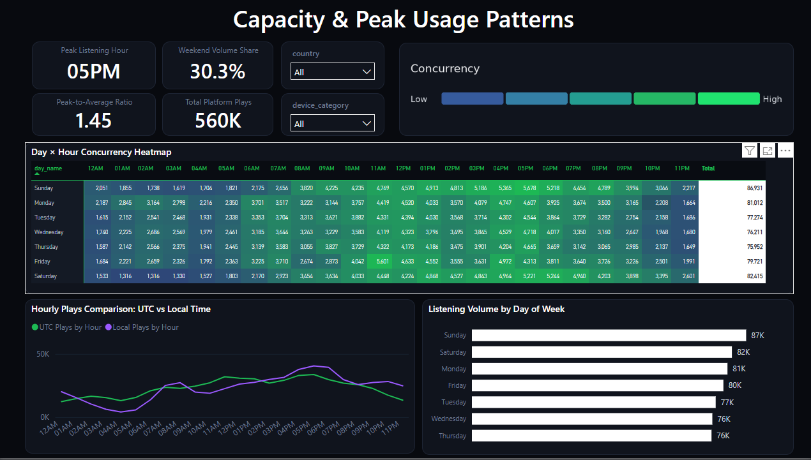

### Page 3: Catalog Performance Trends
Content trends analyzing rising vs. falling musical genres, artist market share breakdown, track popularity distribution, and skip-rate vs. completion rate performance quadrant.
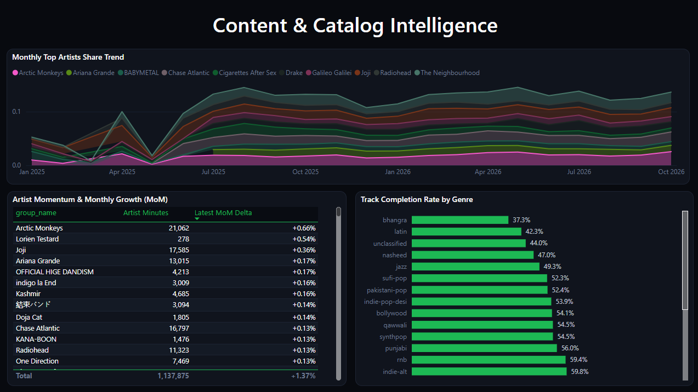

### Page 4: User Behaviors & Subscription Propensity
Commercial intelligence canvas identifying high-propensity free tier listeners ready for premium conversion, engagement distributions, and flagged churn-risk premium subscribers.
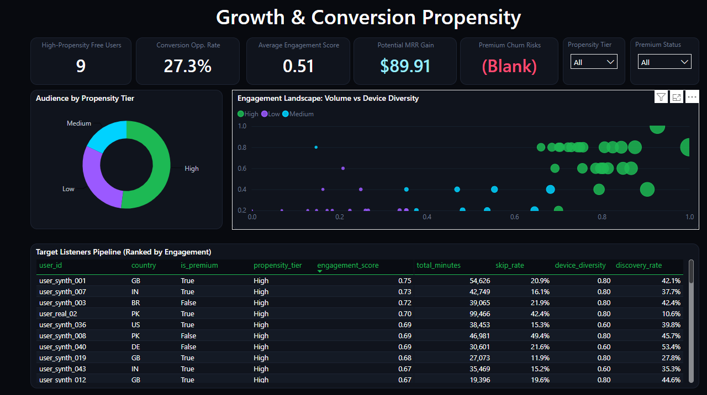

### Page 5: Pipeline Observability & Operations
Lakehouse operations cockpit tracking end-to-end batch executions, layer run durations across Bronze/Silver/Gold, automated quarantine rejection rates, and live data freshness high-water marks.
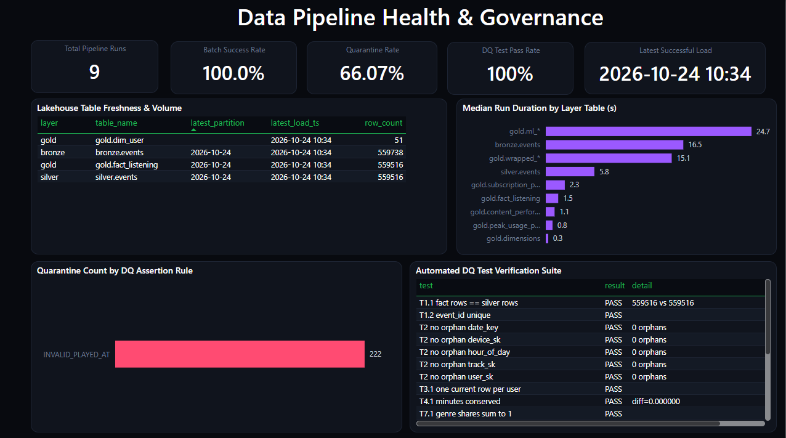

---

## 5. Consumer Experience: Spotify Wrapped Storyboard

In addition to enterprise business analytics, the lakehouse powers a personalized consumer "Wrapped" experience via `Mixtape_Wrapped_storyboard.html` and 9 interactive narrative cards (`pics/wrapped_01.png` through `pics/wrapped_09.png`):

| Slide | Visual | Description |
|---|---|---|
| **01** | 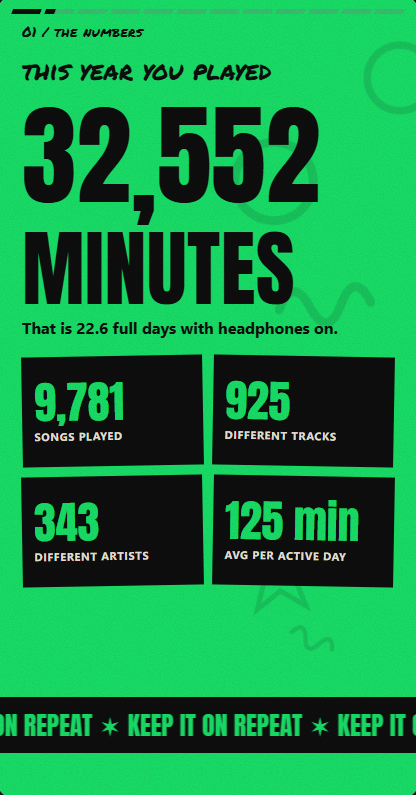 | Annual Total Minutes & Listening Time Benchmark |
| **02** | 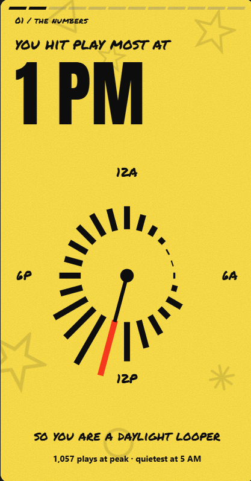 | Top 5 Artists of the Year & Play Counts |
| **03** | 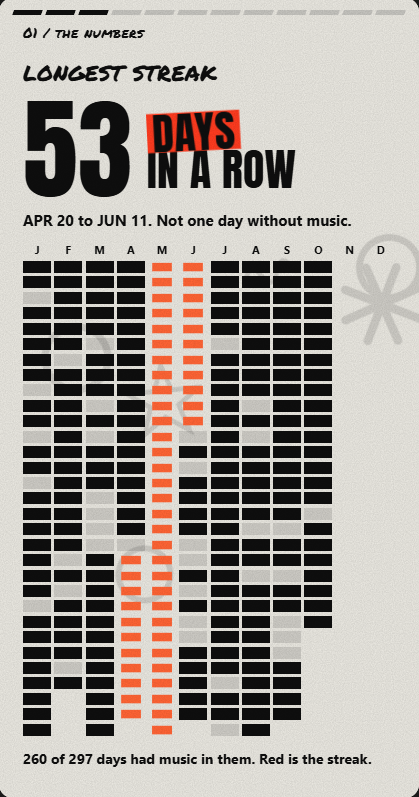 | Top Tracks & Most Played Anthems |
| **04** | 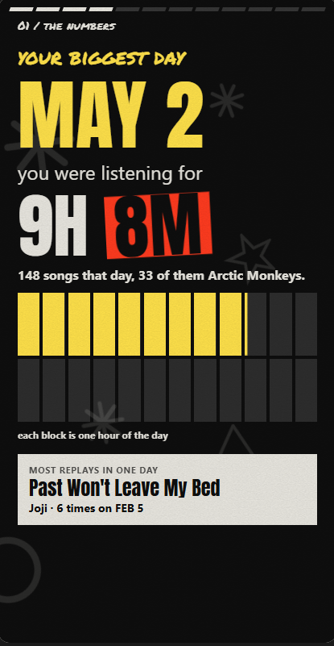 | Genre Breakdown & Musical Diversity Radar |
| **05** | 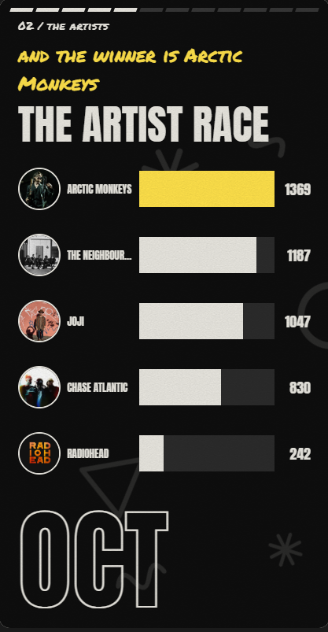 | Listening Personality & Audio Trait Profile |
| **06** | 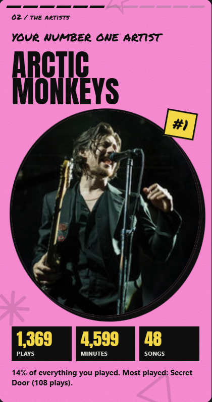 | Monthly Listening Arc & Peak Listening Season |
| **07** | 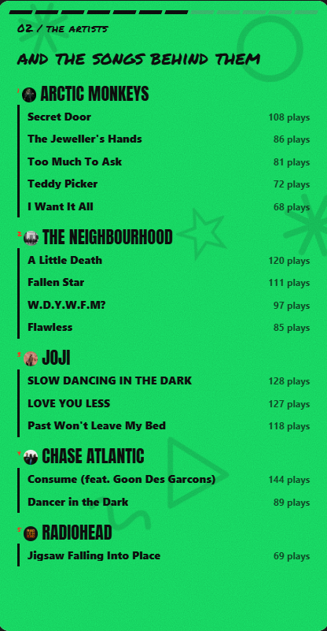 | Listening Age & Discovery Chronology |
| **08** | 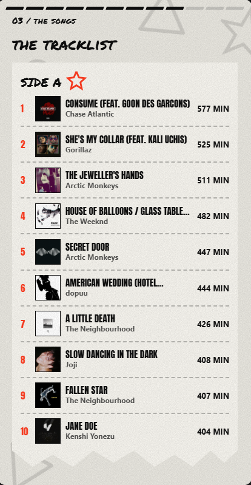 | Longest Listening Streak & Day-Part Distribution |
| **09** | 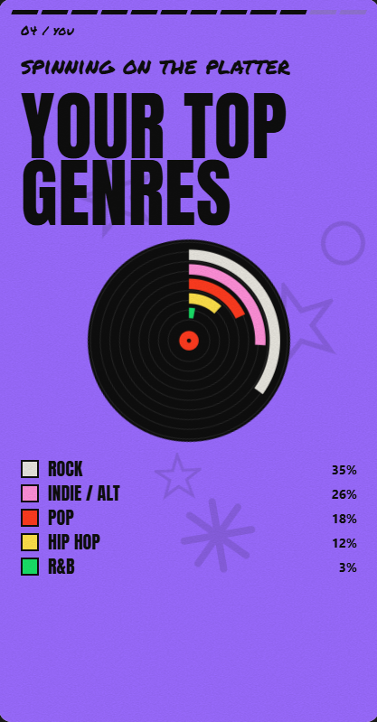 | Annual Badge & Persona Summary Card |

To view the live web storyboard, open `Mixtape_Wrapped_storyboard.html` in any modern web browser.
