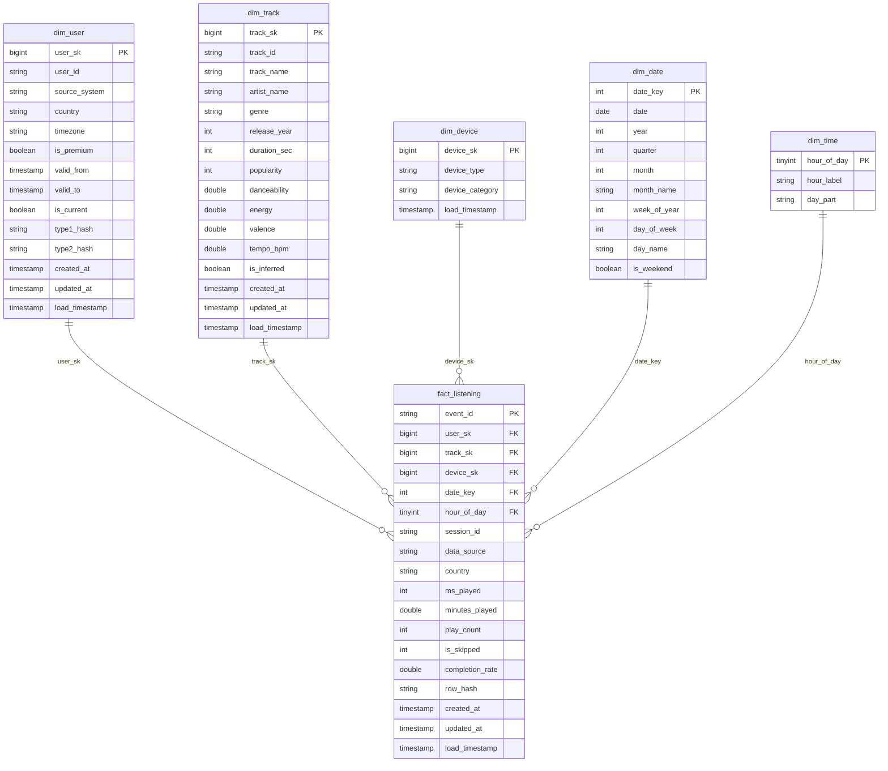

# Gold Layer Data Dictionary & Star Schema Specification

## 1. Overview & Architecture

The **Gold Layer** serves as the curated, business-level presentation and feature layer in the Spotify Medallion Lakehouse. It transforms cleansed, validated Silver tables into an optimized Star Schema (Kimball dimensional modeling), ML-ready feature tables, and aggregated business data marts.

All writes in the Gold layer are executed as atomic Delta Lake transactions. The primary transaction fact table utilizes **Liquid Clustering** and is incrementally refreshed using **Delta Change Data Feed (CDF)**.

---

## 2. Surrogate Key Conventions & Design Decisions

1. **Deterministic Surrogate Keys (`xxhash64`)**:
   Instead of auto-incrementing identity columns (which complicate concurrent MERGEs, backfills, and Delta `RESTORE` time travel), all surrogate keys are computed deterministically via `xxhash64`:
   - `user_sk = xxhash64(user_id || '||' || valid_from)`
   - `track_sk = xxhash64(track_id)`
   - `device_sk = xxhash64(device_type)`
   Collision probability for 64-bit Murmur/xxHash at tens of thousands of entities is less than $10^{-11}$.

2. **The Unknown Member (`-1`)**:
   Dimension tables (`dim_user`, `dim_track`, `dim_device`) contain a permanent surrogate key record `-1` representing "Unknown / Unresolved". Any fact record with an unresolved foreign key references `-1`, preserving referential integrity and preventing data loss.

3. **Inferred Dimension Members**:
   When early-arriving fact events reference a `track_id` not yet present in `silver.tracks` (e.g. from real-time API streaming), `30_gold_dims` automatically creates an inferred record in `dim_track` with `is_inferred = true` and `genre = 'unclassified'`. When catalog dimensions arrive, SCD1 MERGE updates track metadata and flips `is_inferred = false` without changing `track_sk`.

4. **Slowly Changing Dimensions (SCD Type 2 vs Type 1)**:
   - `dim_user` implements **SCD Type 2** for subscription status changes (`is_premium`), maintaining full historical fidelity of user tiers.
   - `country` and `timezone` are treated as **SCD Type 1** attributes (overwriting current profile attributes).
   - Point-in-time joins in `fact_listening` match:
     `fact.played_at >= dim_user.valid_from AND fact.played_at < dim_user.valid_to`.

---

## 3. Dimensional Tables (Gold Star Schema)

### 3.1 `gold.dim_user`
- **Granularity:** One record per user per subscription tier validity period.
- **SCD Policy:** Type 2 on `is_premium`; Type 1 on `country`, `timezone`.
- **Clustering:** Liquid Clustering (`CLUSTER BY (user_id)`).

| Column | Type | Nullable | Description & Business Rules |
|---|---|---|---|
| `user_sk` | `BIGINT` | NO | Deterministic PK: `xxhash64(user_id \|\| valid_from)`. |
| `user_id` | `STRING` | NO | Natural business key (e.g., `user_synth_001`, `user_real_01`). |
| `source_system` | `STRING` | NO | `real` if user_id starts with `user_real_`, else `synthetic`. |
| `country` | `STRING` | NO | Country ISO code (Type 1 updated). |
| `timezone` | `STRING` | NO | Local timezone string (e.g., `America/New_York`). |
| `is_premium` | `BOOLEAN` | NO | Type 2 tracked: Free (`false`) vs. Premium (`true`). |
| `valid_from` | `TIMESTAMP` | NO | Effective start timestamp (`1900-01-01` for initial version). |
| `valid_to` | `TIMESTAMP` | NO | Effective end timestamp (`9999-12-31` for active record). |
| `is_current` | `BOOLEAN` | NO | `true` if active version, `false` if historical. |
| `type1_hash` | `STRING` | NO | MD5 hash of `country`, `timezone` for Type 1 drift detection. |
| `type2_hash` | `STRING` | NO | MD5 hash of `is_premium` for Type 2 version triggering. |
| `created_at` | `TIMESTAMP` | NO | Ingestion timestamp of version creation. |
| `updated_at` | `TIMESTAMP` | NO | Ingestion timestamp of last metadata update. |
| `load_timestamp`| `TIMESTAMP`| NO | Pipeline run execution timestamp. |

### 3.2 `gold.dim_track`
- **Granularity:** One record per distinct track.
- **SCD Policy:** Type 1 MERGE + Inferred member handling.
- **Clustering:** Liquid Clustering (`CLUSTER BY (track_id, genre)`).

| Column | Type | Nullable | Description & Business Rules |
|---|---|---|---|
| `track_sk` | `BIGINT` | NO | Deterministic PK: `xxhash64(track_id)`. |
| `track_id` | `STRING` | NO | Natural business key (Spotify Track URI/ID). |
| `track_name` | `STRING` | NO | Name of track or `Unknown Track` if inferred. |
| `artist_name` | `STRING` | NO | Primary artist name or `Unknown Artist` if inferred. |
| `genre` | `STRING` | NO | Standardized genre taxonomy (`rock`, `jpop`, `punjabi`, etc.). |
| `release_year` | `INT` | YES | Album release year (nullable for exports lacking metadata). |
| `duration_sec` | `INT` | NO | Duration of track in seconds. |
| `popularity` | `INT` | NO | Normalized catalog popularity (0 to 100). |
| `danceability` | `DOUBLE` | NO | Algorithmic pseudo audio-feature (0.0 to 1.0). |
| `energy` | `DOUBLE` | NO | Algorithmic pseudo audio-feature (0.0 to 1.0). |
| `valence` | `DOUBLE` | NO | Musical positiveness metric (0.0 to 1.0). |
| `tempo_bpm` | `DOUBLE` | NO | Track tempo in beats per minute. |
| `is_inferred` | `BOOLEAN` | NO | `true` if auto-generated by fact pipeline before catalog load. |
| `created_at` | `TIMESTAMP` | NO | Initial record insertion timestamp. |
| `updated_at` | `TIMESTAMP` | NO | Metadata update timestamp. |
| `load_timestamp`| `TIMESTAMP`| NO | Pipeline run execution timestamp. |

### 3.3 `gold.dim_device`
- **Granularity:** One record per unique device category.
- **SCD Policy:** Type 1 MERGE. 5 canonical Silver values + Unknown member (`-1`).

| Column | Type | Nullable | Description & Business Rules |
|---|---|---|---|
| `device_sk` | `BIGINT` | NO | Deterministic PK: `xxhash64(device_type)`. |
| `device_type` | `STRING` | NO | Natural key: `mobile`, `desktop`, `web_player`, `smart_speaker`, `other`. |
| `device_category`| `STRING`| NO | High-level grouping (`mobile`, `desktop`, `web`, `smart_speaker`, `other`). |
| `load_timestamp`| `TIMESTAMP`| NO | Pipeline run execution timestamp. |

### 3.4 `gold.dim_date`
- **Granularity:** One record per calendar day spanning dataset minimum to maximum + 365 days.
- **SCD Policy:** Generated calendar table.

| Column | Type | Nullable | Description & Business Rules |
|---|---|---|---|
| `date_key` | `INT` | NO | Integer PK formatted as `YYYYMMDD` (e.g., `20261022`). |
| `date` | `DATE` | NO | Standard ANSI Date (`YYYY-MM-DD`). |
| `year` | `INT` | NO | Calendar year (e.g., `2026`). |
| `quarter` | `INT` | NO | Calendar quarter (1 to 4). |
| `month` | `INT` | NO | Calendar month (1 to 12). |
| `month_name` | `STRING` | NO | Full month name (e.g., `October`). |
| `week_of_year` | `INT` | NO | ISO week number of the year (1 to 53). |
| `day_of_week` | `INT` | NO | Spark day of week (1 = Sunday, 7 = Saturday). |
| `day_name` | `STRING` | NO | Day name (e.g., `Thursday`). |
| `is_weekend` | `BOOLEAN` | NO | `true` if day_of_week IN (1, 7). |

### 3.5 `gold.dim_time`
- **Granularity:** 24 records representing each hour of the day (0 to 23).

| Column | Type | Nullable | Description & Business Rules |
|---|---|---|---|
| `hour_of_day` | `TINYINT`| NO | Primary Key (0 to 23). |
| `hour_label` | `STRING` | NO | Formatted 12-hour label (`12 AM`, `01 AM`, ... `11 PM`). |
| `day_part` | `STRING` | NO | Day segment: `Night` (0-5), `Morning` (6-11), `Afternoon` (12-17), `Evening` (18-23). |

---

## 4. Fact Table

### 4.1 `gold.fact_listening`
- **Granularity:** One row per individual listening play event.
- **Ingestion Pattern:** Incremental ingestion via **Delta Change Data Feed (CDF)** on `silver.events`.
- **Clustering:** Liquid Clustering (`CLUSTER BY (date_key, user_sk)`).

| Column | Type | Nullable | Description & Business Rules |
|---|---|---|---|
| `event_id` | `STRING` | NO | Primary Key from Silver event. |
| `user_sk` | `BIGINT` | NO | FK to `dim_user` matched point-in-time at `played_at`. Defaults to `-1`. |
| `track_sk` | `BIGINT` | NO | FK to `dim_track` matched on `track_id`. Defaults to `-1`. |
| `device_sk` | `BIGINT` | NO | FK to `dim_device` matched on `device_type`. Defaults to `-1`. |
| `date_key` | `INT` | NO | FK to `dim_date` (`YYYYMMDD` of UTC `played_at`). |
| `hour_of_day` | `TINYINT`| NO | FK to `dim_time` (0 to 23 of UTC `played_at`). |
| `session_id` | `STRING` | NO | Degenerate dimension: 30-minute inactivity session UUID. |
| `data_source` | `STRING` | NO | `synthetic`, `real`, `real_api`, `synthetic_persona_matched`. |
| `country` | `STRING` | NO | Country code of user at event time. |
| `ms_played` | `INT` | YES | Play duration in ms (NULL for `real_api`). |
| `minutes_played`| `DOUBLE` | YES | `ms_played / 60000.0`. Null for `real_api`. |
| `play_count` | `INT` | NO | Constant `1` for additive play aggregation. |
| `is_skipped` | `INT` | YES | `1` if skipped, `0` if completed, NULL for `real_api`. |
| `completion_rate`| `DOUBLE`| YES | `ms_played / (duration_sec * 1000)`. Null for `real_api`. |
| `_row_hash` | `STRING` | NO | SHA256 of business and measure attributes for MERGE change detection. |
| `created_at` | `TIMESTAMP` | NO | Initial insertion timestamp. |
| `updated_at` | `TIMESTAMP` | NO | Last update timestamp. |
| `load_timestamp`| `TIMESTAMP`| NO | Pipeline run execution timestamp. |

---

## 5. Machine Learning Feature Store

### 5.1 `gold.ml_user_track_interactions`
User-item interaction matrix capturing affinity, replay volume, and skip propensities for collaborative filtering and recommendation models (ALS).
- **Grain:** `(user_id, track_id)`

| Column | Type | Description |
|---|---|---|
| `user_id` | `STRING` | Listener business ID. |
| `track_id` | `STRING` | Track business ID. |
| `total_plays` | `INT` | Total play count. |
| `total_minutes` | `DOUBLE` | Cumulative listening minutes. |
| `completed_plays`| `INT` | Plays reaching completion. |
| `skipped_plays` | `INT` | Plays skipped before 30s. |
| `implicit_rating`| `DOUBLE` | Calculated rating: $\log(1 + \text{plays}) \times (1 - \text{skip\_rate})$. |
| `last_played_at`| `TIMESTAMP` | Most recent interaction timestamp. |
| `load_timestamp`| `TIMESTAMP` | Feature computation timestamp. |

### 5.2 `gold.ml_track_features`
Audio feature representations and popularity vectors for content-based clustering and playlist generation.
- **Grain:** `track_id`

| Column | Type | Description |
|---|---|---|
| `track_id` | `STRING` | Track ID. |
| `danceability` | `DOUBLE` | Movement suitability. |
| `energy` | `DOUBLE` | Perceptual intensity and activity. |
| `valence` | `DOUBLE` | Musical positiveness. |
| `tempo_bpm` | `DOUBLE` | Beats per minute. |
| `popularity` | `INT` | Relative catalog popularity. |
| `duration_sec` | `INT` | Track duration. |
| `genre` | `STRING` | Primary genre label. |
| `load_timestamp`| `TIMESTAMP` | Feature computation timestamp. |

### 5.3 `gold.ml_user_sessions`
Session-level behavioral metrics for churn forecasting and engagement scoring.
- **Grain:** `session_id`

| Column | Type | Description |
|---|---|---|
| `session_id` | `STRING` | 30-min window session ID. |
| `user_id` | `STRING` | Listener business ID. |
| `session_start` | `TIMESTAMP` | First play timestamp. |
| `session_end` | `TIMESTAMP` | Last play timestamp. |
| `duration_minutes`| `DOUBLE` | Total session elapsed duration. |
| `event_count` | `INT` | Number of tracks played. |
| `distinct_tracks`| `INT` | Number of unique tracks. |
| `distinct_artists`| `INT` | Number of unique artists. |
| `skip_count` | `INT` | Number of skipped tracks in session. |
| `primary_device` | `STRING` | Predominant device type in session. |
| `load_timestamp` | `TIMESTAMP` | Feature computation timestamp. |

---

## 6. Business Data Marts

### 6.1 `gold.peak_usage_patterns` (Business Q1: Capacity & Peak Usage)
Aggregates listening activity across time dimensions, local hours, device types, and geographic markets.

| Column | Type | Description |
|---|---|---|
| `utc_hour` | `TINYINT` | UTC hour of play (0-23) for server capacity planning. |
| `local_hour` | `TINYINT` | Local listener hour calculated using user's timezone. |
| `day_of_week` | `INT` | 1 = Sunday, 7 = Saturday. |
| `day_name` | `STRING` | Sunday, Monday, etc. |
| `device_category`| `STRING` | mobile, desktop, web, smart_speaker, other. |
| `country` | `STRING` | User country code. |
| `total_plays` | `BIGINT` | Total aggregate play events. |
| `total_minutes` | `DOUBLE` | Total minutes played. |
| `load_timestamp` | `TIMESTAMP` | Ingestion timestamp. |

### 6.2 `gold.subscription_propensity_segments` (Business Q2: Conversion Targeting)
Calculates composite engagement scores for free listeners to identify high-probability conversion candidates.

$$\text{engagement\_score} = 0.40 \times \text{volume\_norm} + 0.20 \times \text{device\_diversity} + 0.20 \times (1 - \text{skip\_rate}) + 0.20 \times \text{discovery\_rate}$$

| Column | Type | Description |
|---|---|---|
| `user_id` | `STRING` | Listener ID. |
| `is_premium` | `BOOLEAN` | Current subscription status. |
| `country` | `STRING` | Listener country. |
| `total_minutes` | `DOUBLE` | Total lifetime minutes played. |
| `total_plays` | `BIGINT` | Total lifetime plays. |
| `distinct_devices`| `INT` | Number of unique device categories used. |
| `device_diversity`| `DOUBLE` | Normalized device entropy score (0.0 to 1.0). |
| `skip_rate` | `DOUBLE` | Ratio of skipped plays to total plays with skip info. |
| `discovery_rate` | `DOUBLE` | Ratio of plays on tracks not played in prior 60 days (60-day lookback, `real_api` rows excluded). |
| `volume_norm` | `DOUBLE` | Log-transformed and min-max normalized play volume. |
| `engagement_score`| `DOUBLE` | Weighted composite propensity score (0.0 to 1.0). |
| `propensity_tier` | `STRING` | `High` ($\ge 0.55$), `Medium` ($\ge 0.35$), `Low` ($< 0.35$). |
| `is_high_conversion_propensity`| `BOOLEAN` | `true` if `NOT is_premium AND engagement_score >= 0.55`. |
| `churn_risk_flag` | `BOOLEAN` | `true` if `is_premium = true AND propensity_tier = 'Low'`; flags premium subscribers whose engagement score fell below the Low tier — earliest warning of churn. |
| `load_timestamp` | `TIMESTAMP` | Mart build timestamp. |

### 6.3 `gold.content_performance_trends` (Business Q3: Market Trends)
Tracks month-over-month listening share and delta trends across genres and artists.

| Column | Type | Description |
|---|---|---|
| `year` | `INT` | Play calendar year. |
| `month` | `INT` | Play calendar month (1-12). |
| `genre` | `STRING` | Standardized genre name. |
| `artist_name` | `STRING` | Artist name. |
| `monthly_minutes`| `DOUBLE` | Total listening minutes for artist in genre in month. |
| `genre_monthly_minutes`| `DOUBLE` | Total listening minutes for the entire genre in month. |
| `genre_market_share`| `DOUBLE` | Share of total platform listening minutes in month. |
| `prev_month_share`| `DOUBLE` | Lagged genre market share from previous month. |
| `mom_delta` | `DOUBLE` | Percentage point growth or decline ($\text{share} - \text{prev\_share}$). |
| `load_timestamp` | `TIMESTAMP` | Mart build timestamp. |

### 6.4 `gold.wrapped_user_year` (Consumer Wrapped Experience)

One row per user per year, shaped to drive the `Mixtape_Wrapped_storyboard.html`
storyboard. Replaces the earlier flat `top_*` columns with nested `STRUCT`/`ARRAY`
fields the storyboard consumes directly.

| Column | Type | Description |
|---|---|---|
| `user_id` | `STRING` | Listener ID. |
| `year` | `INT` | Wrapped calendar year (e.g., 2026). |
| `total_minutes` | `DOUBLE` | Total listening minutes (all plays). |
| `total_plays` | `BIGINT` | Non-skipped play count. |
| `total_events` | `BIGINT` | All plays incl. skipped. |
| `distinct_tracks` | `INT` | Distinct tracks played. |
| `distinct_artists` | `INT` | Distinct artists played. |
| `active_days` | `INT` | Days with at least one play. |
| `span_days` | `INT` | Days between first and last play. |
| `skip_pct` | `DOUBLE` | Share of plays skipped (%). |
| `skip_count` | `BIGINT` | Number of skipped plays. |
| `skip_worst_artists` | `ARRAY<STRUCT<name, pct, plays>>` | Top 3 artists by skip rate (≥80 plays). |
| `biggest_day` | `STRUCT<month, day, minutes, artist, plays, artist_plays>` | Biggest listening day + top artist. |
| `most_replayed` | `STRUCT<month, day, title, artist, times>` | Most-replayed track in one day. |
| `longest_streak` | `STRUCT<length, start_month, start_day, end_month, end_day>` | Longest consecutive-day streak. |
| `calendar` | `ARRAY<STRING>` | 12 strings × 31 chars (`1`=active, `2`=streak, `0`=off, `-`=N/A). |
| `hours` | `ARRAY<INT>` | 24 hourly play counts (index 0-23). |
| `top_artists` | `ARRAY<STRUCT<name, plays, minutes, distinct_tracks>>` | Top 5 artists by plays. |
| `top_tracks` | `ARRAY<STRUCT<title, artist, plays, minutes>>` | Top 10 tracks by minutes. |
| `top_genres` | `ARRAY<STRUCT<name, pct>>` | Top 5 genres by share. |
| `by_artist_tracks` | `ARRAY<ARRAY<STRUCT<title, plays>>>` | Per top-5 artist: top tracks. |
| `monthly_plays` | `ARRAY<ARRAY<INT>>` | Per top-5 artist: 12 monthly play counts. |
| `peak_hour` | `INT` | Most common hour of day. |
| `discovery_rate` | `DOUBLE` | 60-day discovery rate (from propensity mart). |
| `load_timestamp` | `TIMESTAMP` | Mart build timestamp. |

---

## 7. Lakehouse Audit & Observability Marts

### 7.1 `gold.audit_pipeline_runs`
Aggregates run metrics from `ops.pipeline_execution_logs` across pipeline layers and tables.

| Column | Type | Description |
|---|---|---|
| `run_date` | `DATE` | Execution date. |
| `layer` | `STRING` | Pipeline layer (`BRONZE_TO_SILVER`, `SILVER_TO_GOLD`, etc.). |
| `target_table` | `STRING` | Target Delta table name. |
| `run_count` | `INT` | Execution count. |
| `success_count` | `INT` | Successful commit count. |
| `failure_count` | `INT` | Failed execution count. |
| `rows_read_sum` | `BIGINT` | Cumulative records read from source. |
| `rows_out_sum` | `BIGINT` | Cumulative records inserted + updated. |
| `duration_p50` | `DOUBLE` | Median execution duration in seconds. |
| `duration_max` | `DOUBLE` | Peak execution duration in seconds. |
| `error_message` | `STRING` | Most recent `error_message` for this table (NULL if all runs succeeded). Surfaces `SCHEMA_DRIFT` notes and exception text for failed runs. |
| `schema_drift_event_count` | `INT` | Count of runs in this group where `error_message LIKE '%SCHEMA_DRIFT%'`, enabling trend analysis of structural changes arriving from upstream. |
| `load_timestamp` | `TIMESTAMP` | Aggregation timestamp. |

### 7.2 `gold.audit_quality_summary`
Observability mart tracking data hygiene, schema enforcement, and quarantine rejection rates. **Exposes aggregated metrics only—zero raw record text or PII.**

| Column | Type | Description |
|---|---|---|
| `partition_dt` | `DATE` | Date partition of ingested data. |
| `quarantine_stage`| `STRING` | `BRONZE` (structural corruption) or `SILVER` (business rule failure). |
| `rule_or_reason`| `STRING` | Quarantine rule triggered (e.g. `INVALID_TIMESTAMP`, `NEGATIVE_PLAY_TIME`). |
| `quarantined_records`| `BIGINT`| Count of quarantined rows. |
| `total_ingested_records`| `BIGINT`| Total records presented for ingestion on that date. |
| `quarantine_rate`| `DOUBLE`| Percentage of records quarantined (`quarantined / total`). |
| `alert_flag` | `BOOLEAN` | `true` if quarantine rate exceeds threshold ($> 2.0\%$). |
| `load_timestamp` | `TIMESTAMP` | Aggregation timestamp. |

### 7.3 `gold.audit_freshness`
Tracks high-water marks, freshness, and catalog coverage across every layer of the lakehouse.

| Column | Type | Description |
|---|---|---|
| `layer` | `STRING` | `BRONZE`, `SILVER`, `GOLD`. |
| `table_name` | `STRING` | Fully qualified table name. |
| `latest_partition_dt`| `DATE` | Maximum partition date present in table. |
| `latest_load_timestamp`| `TIMESTAMP` | Most recent execution timestamp committed. |
| `total_row_count` | `BIGINT` | Current active row count. |
| `unclassified_track_share`| `DOUBLE` | *Catalog tables only (`silver.tracks`, `gold.dim_track`).* Share of rows with `genre = 'unclassified'`. Indicates how much of the catalog still needs `artist_genres.json` entries. NULL for non-catalog tables. |
| `inferred_track_count` | `BIGINT` | *`gold.dim_track` only.* Count of `is_inferred = true` rows — tracks referenced by fact events but not yet in the catalog snapshot. NULL for other tables. |
| `load_timestamp` | `TIMESTAMP` | Refresh timestamp. |

### 7.4 `gold.audit_test_results`
Captures automated test execution outcomes and integrity assertions across dimensions, facts, measures, and Wrapped business rules.

| Column | Type | Description |
|---|---|---|
| `test` | `STRING` | Test identifier and assertion name (e.g. `T1.1 fact rows == silver rows`, `T2 no orphan user_sk`, `W1 wrapped minutes`). |
| `result` | `STRING` | Outcome status: `PASS`, `FAIL`, or `INFO`. |
| `detail` | `STRING` | Diagnostic details, compared row counts, delta metrics, or empty on standard pass. |
| `load_timestamp` | `TIMESTAMP` | Verification execution timestamp. |

### 7.5 `gold.audit_event_funnel`
Tracks end-to-end event reconciliation and volume retention by user and year across each stage of the pipeline lifecycle.

| Column | Type | Description |
|---|---|---|
| `user_id` | `STRING` | Pseudonymous user identifier. |
| `yr` | `INT` | Calendar year (e.g. 2025, 2026). |
| `bronze_events` | `BIGINT` | Total raw play records ingested into Bronze. |
| `quarantined_INVALID_PLAYED_AT` | `BIGINT` | Count of records routed to Silver quarantine due to invalid or future timestamps. |
| `silver_events` | `BIGINT` | Clean, conformed events successfully merged into Silver. |
| `null_ms_played_dropped_from_wrapped` | `BIGINT` | Events excluded from time-duration Wrapped metrics due to null play durations. |
| `skips_under_30s` | `BIGINT` | Track plays skipped before 30 seconds of playback. |
| `qualified_plays` | `BIGINT` | Full, qualified listening plays retained in Gold reporting. |
| `load_timestamp` | `TIMESTAMP` | Funnel calculation timestamp. |

---

## 8. New Analytical Marts

### 8.1 `gold.user_activity_daily`
Daily per-user listening summary. Feeds cohort analysis, churn prediction, and DAU/MAU stickiness calculations. Grain: `(user_id, activity_date)`.

| Column | Type | Description |
|---|---|---|
| `user_id` | `STRING` | Listener ID. |
| `activity_date` | `DATE` | UTC calendar date (from `_partition_dt`). |
| `is_premium` | `BOOLEAN` | Subscription status at this date (current-version join). |
| `total_plays` | `BIGINT` | Play events on this date. |
| `total_minutes` | `DOUBLE` | Listening minutes on this date. |
| `distinct_tracks` | `INT` | Unique tracks played. |
| `distinct_genres` | `INT` | Unique genres played. |
| `skip_count` | `BIGINT` | Skipped plays on this date. |
| `skip_rate` | `DOUBLE` | `skip_count / total_plays`. |
| `primary_device` | `STRING` | Most-used device category on this date. |
| `load_timestamp` | `TIMESTAMP` | Mart build timestamp. |

### 8.2 `gold.user_cohort_retention`
Monthly cohort retention matrix. For each cohort (first-listen month) and each subsequent offset month, records how many original users returned. Grain: `(cohort_month, offset_month_number)`.

| Column | Type | Description |
|---|---|---|
| `cohort_month` | `INT` | `yyyyMM` of the user's first-ever play. |
| `offset_months` | `INT` | Months since cohort entry (0 = signup month, 1 = M+1, …). |
| `cohort_size` | `BIGINT` | Users who first played in `cohort_month`. |
| `retained_users` | `BIGINT` | Users from that cohort still active in `cohort_month + offset_months`. |
| `retention_rate` | `DOUBLE` | `retained_users / cohort_size`. |
| `load_timestamp` | `TIMESTAMP` | Mart build timestamp. |

### 8.3 `gold.skip_by_genre_artist`
Skip-rate and completion breakdown by genre and artist. Grain: `(genre, artist_name, year_month)`.

| Column | Type | Description |
|---|---|---|
| `genre` | `STRING` | Standardized genre label. |
| `artist_name` | `STRING` | Primary artist name. |
| `year_month` | `INT` | `yyyyMM` period. |
| `total_plays` | `BIGINT` | Play events. |
| `skip_count` | `BIGINT` | Skipped plays. |
| `skip_rate` | `DOUBLE` | `skip_count / total_plays`. |
| `avg_completion_rate`| `DOUBLE` | Mean `completion_rate` (excluding NULL `real_api` rows). |
| `total_minutes` | `DOUBLE` | Listening minutes. |
| `load_timestamp` | `TIMESTAMP` | Mart build timestamp. |
