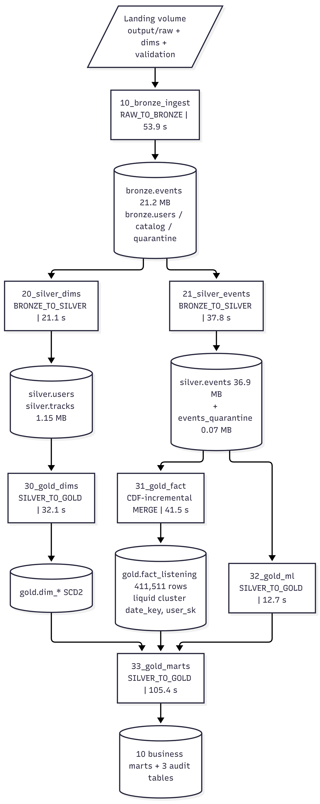
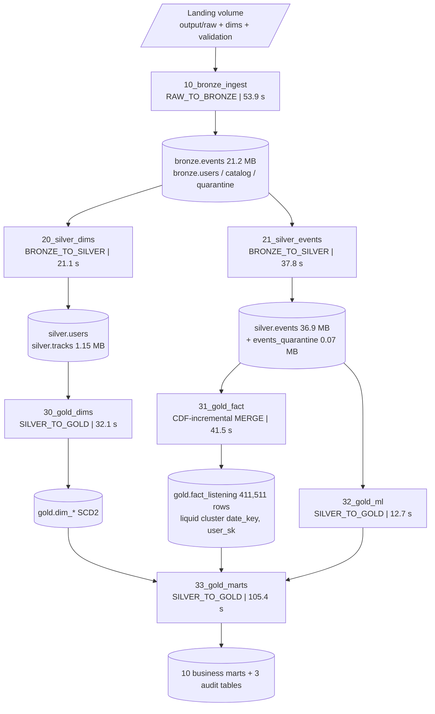

# Pipeline DAG — Fresh Full Run Evidence (2026-10-23)

All 33 logged steps succeeded across the 7 batches below (source: `workspace.ops.pipeline_execution_logs`,
evidence file `01_full_run_log.txt`). 3 pre-retry planning errors (peak_usage_patterns, user_activity_daily,
skip_by_genre_artist) all succeeded on immediate rerun.

## Batch → step map

| # | Notebook | Layer | Batch ID | Duration | Key rows |
|---|---|---|---|---|---|
| 1 | 10_bronze_ingest | RAW_TO_BRONZE | `batch_083b09f0…` | 53.9 s | 4,431 event rows (4 backfill files dt=10-20..23, schema drift `ms_played_source` rescued); users + catalog SKIPPED_UNCHANGED |
| 2 | 20_silver_dims | BRONZE_TO_SILVER | `batch_61a9b475…` | 21.1 s | users 50; tracks 16,484 |
| 3 | 21_silver_events | BRONZE_TO_SILVER | `batch_c255f890…` | 37.8 s | read 36,748 → insert 3,593 + update 32,781; 1,847 quarantined (INVALID_PLAYED_AT) |
| 4 | 30_gold_dims | SILVER_TO_GOLD | `batch_7e54c0ae…` | 32.1 s | dim_date 734, dim_time 24, dim_device 6, dim_track 16,493, dim_user 50 |
| 5 | 31_gold_fact | SILVER_TO_GOLD | `batch_03cfb211…` | 41.5 s | fact_listening bootstrap MERGE 411,511 rows (CDF v0..v23) |
| 6 | 32_gold_ml | SILVER_TO_GOLD | `batch_3f4626b9…` | 12.7 s | interactions 84,481; track features 13,428; sessions 35,627 |
| 7 | 33_gold_marts | SILVER_TO_GOLD | `batch_3db2fa06…` | 105.4 s | peak 4,919 · propensity 50 · content 23,988 · wrapped 100 · activity 33,118 · cohort 13 · skip 23,753 · audits 40/1/7 |

**Total logged duration: 304.5 s** (excludes the 01_setup DDL step, which does not log).

Orchestration note: the official `run_pipeline` driver uses `dbutils.notebook.run`, which hits serverless timeouts;
the full run was executed per-notebook (each notebook logs its own batch ID, as above). `run_pipeline` also carries
the post-run proof cells (execution log, ingestion log) and the evidence-capture cells at the bottom
(EXPLAIN FORMATTED ×2 + measured-values writer) for screenshot capture.
